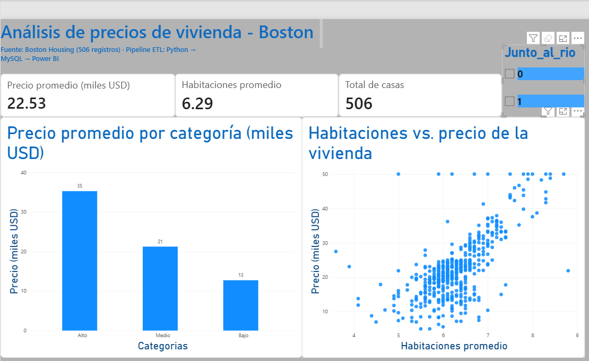

# Pipeline ETL: Boston Housing (CSV → MySQL → Power BI)

Proyecto de análisis de datos que extrae información de vivienda desde un archivo CSV, la limpia y transforma con Python y la carga en una base de datos MySQL para visualizarla en Power BI.



## Qué hace

1. **Extract:** lee el archivo `data/Boston-house-price-data.csv` (506 registros).
2. **Transform:** renombra columnas, revisa nulos y duplicados, valida tipos de datos y crea la columna `categoria_precio` (Bajo, Medio, Alto).
3. **Load:** carga los datos en MySQL (`etl_demo.boston_housing_limpio`) y valida el número de filas cargadas.
4. **Visualización:** dashboard en Power BI conectado a MySQL.

## Herramientas

Python, Pandas, SQLAlchemy, MySQL, Power BI

## Cómo correrlo

1. Instala las librerías:
   ```
     pip install -r requirements.txt
   ```
2. Crea un archivo `.env` con tus datos de conexión:
   ```
   DB_USER=tu_usuario
   DB_PASSWORD=tu_contraseña
   DB_HOST=127.0.0.1
   DB_PORT=3306
   DB_NAME=etl_demo
   ```
3. Ejecuta:
   ```
   python etl_boston.py
   ```

## Hallazgos principales

- Las viviendas de categoría Alta cuestan en promedio casi 3 veces más que las de categoría Baja (35.3 vs 12.7 mil USD).
- A mayor número de habitaciones, mayor precio: existe una relación positiva clara.
- Los precios del dataset original están topados en 50 mil USD, lo que se observa como una línea de puntos en el límite superior.